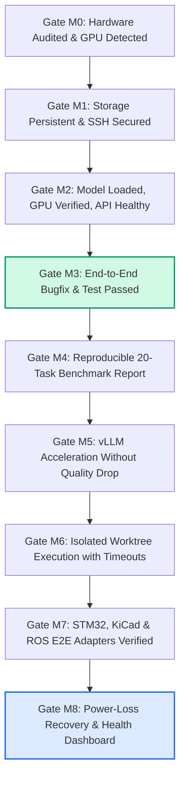

# 9-Phase Roadmap & Release Gates (M0–M8)

This roadmap outlines the complete path from initial hardware discovery to an autonomous, multi-domain AI engineering platform.

---

## 1. Roadmap Overview & Timeline

The platform is designed in progressive phases. **Phase M3 delivers the first fully functional MVP**; later milestones expand throughput, autonomy, and domain coverage.

| Milestone | Title | Focus & Deliverable | Effort | Priority |
|---|---|---|---|---|
| **M0** | **Hardware & System Audit** | Inventory Thor, JetPack, CUDA, GPU detection, baseline report | 0.5–1 Day | **P0** |
| **M1** | **Secure Infrastructure** | Persistent storage `/srv/agentic/`, Docker runtime, SSH isolation | 1–2 Days | **P0** |
| **M2** | **Local LLM Inference** | Ollama container, Qwen3-Coder 30B, GPU validation, API check | 1–2 Days | **P0** |
| **M3** | **Agentic Coding MVP** | SSH tunnel, OpenCode / Claude Code connection, 6 MVP tests | 1–3 Days | **P0** |
| **M4** | **Model Benchmarking** | 20-task benchmark suite, 30B vs 80B, TTFT, tool-call accuracy | 2–3 Days | **P1** |
| **M5** | **Optimized Inference (vLLM)** | vLLM container, Prefix Caching, FP8/NVFP4, KV-cache tuning | 2–4 Days | **P1** |
| **M6** | **Autonomous Execution** | Git worktree lifecycle, container isolation, step limits | 2–4 Days | **P1** |
| **M7** | **Engineering Adapters** | Python, STM32 firmware, KiCad ERC/DRC, ROS 2 containers | 2–4 Days | **P1** |
| **M8** | **Monitoring & Operations** | Observability, health checks, automated recovery, disaster drills | 1–3 Days | **P1** |

---

## 2. Definition of Done (DoD) Quality Gates

A subsequent gate **never replaces** a prior gate. If an optimization in M5 regresses tool-call accuracy established in M3, the configuration is rejected.

### Milestone Acceptance Checklist
- [ ] **M0**: Hardware variant, JetPack 7.x, CUDA version, and storage verified.
- [ ] **M1**: Container runtime operational, NVMe storage isolated, SSH key auth enforced.
- [ ] **M2**: Ollama running locally on Thor; GPU utilization confirmed during token decode.
- [ ] **M3**: Agent on Mac autonomously diagnoses a bug, implements a fix, runs pytest, and outputs a clean git diff.
- [ ] **M4**: Structured benchmark report completed comparing throughput, TTFT, and tool-call schema accuracy.
- [ ] **M5**: vLLM deployed with prefix caching; measured latency improvement on multi-turn prompts.
- [ ] **M6**: Automated task orchestration inside ephemeral Git worktrees with strict timeout and retry guards.
- [ ] **M7**: Automated firmware compilation (STM32), KiCad ERC/DRC validation, and ROS 2 build verified.
- [ ] **M8**: Clean recovery after cold reboot; service status monitored via structured telemetry.

---

## 3. Risk Matrix & Mitigations

| Identified Risk | Impact | Architectural Mitigation Strategy |
|---|---|---|
| **Thor / JetPack Container Drift** | Blocker | Pin exact Docker container digests; verify JetPack 7.2.1 / L4T 39.2.1 compatibility before updating. |
| **Unified Memory Exhaustion** | High | Keep model weights + KV cache under 80 GB; enforce strict memory limits (`--memory`) on build containers. |
| **Tool-Call Schema Hallucination** | High | Use models fine-tuned on Hermes / Anthropic tool-calling schemas (e.g. Qwen3-Coder); test with strict JSON schema validators. |
| **Multi-File Refactoring Corruption** | Medium | Execute all edits in isolated Git worktrees (`../task-xxx`); reject changes failing regression tests. |
| **Infinite Repair / Retry Loops** | Medium | Enforce maximum step limits (e.g., max 15 tool calls per task, max 3 repair attempts per failure). |
| **Unauthorized Hardware Flash** | Critical | Place `st-flash` and `openocd` behind a fail-closed gate requiring interactive human confirmation. |
| **Prompt Injection in Repositories** | High | Treat untrusted source code and issues as passive data; never execute dynamic scripts extracted from unvetted prompt text. |
