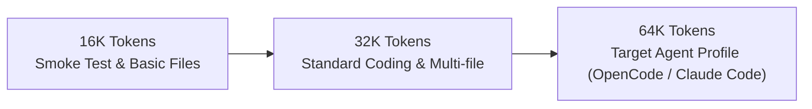
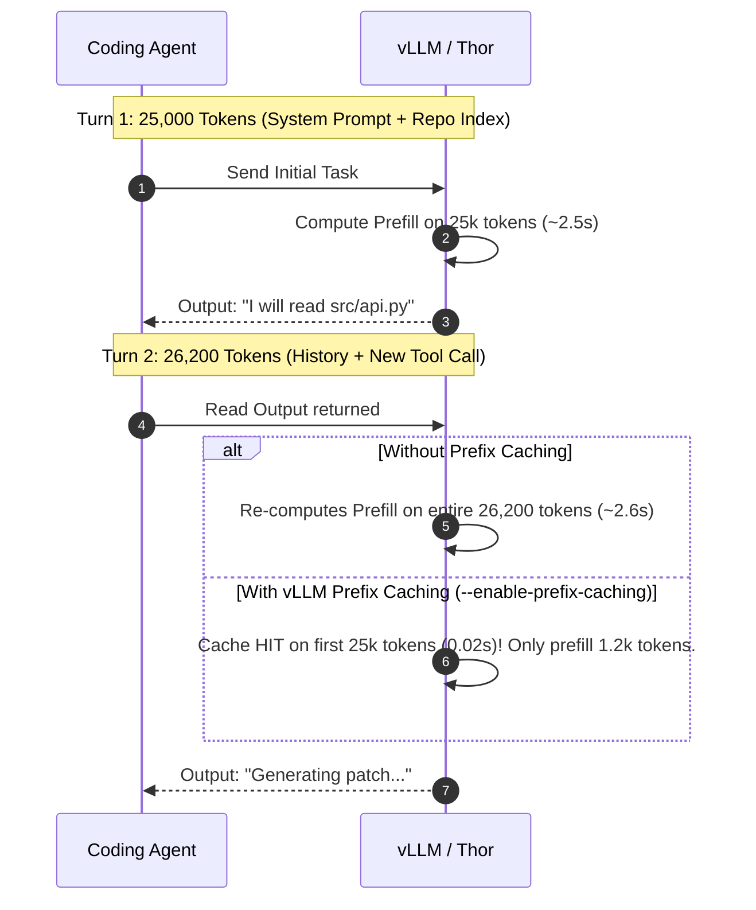

# Local Inference: Ollama, vLLM & Prefix Caching (M2 & M5)

Inference on AGX Thor evolves in two stages: **Ollama for immediate, stable validation (M2)**, followed by **vLLM with Prefix Caching and FP8/NVFP4 for maximum multi-turn agent throughput (M5)**.

---

## 1. Phase M2 — Local Inference with Ollama (Priority P0)

Ollama provides the fastest path to verified GPU inference without complex engine builds.

### 1.1 Running the Ollama Jetson Container

Start Ollama with persistent storage mapped to `/srv/agentic/models/ollama`:

```bash
docker run -d \
  --name ollama-thor \
  --restart unless-stopped \
  --runtime nvidia \
  --gpus all \
  --network host \
  -v /srv/agentic/models/ollama:/root/.ollama \
  -e OLLAMA_HOST="127.0.0.1:11434" \
  ollama/ollama:latest
```

### 1.2 Pulling the Primary Coding Model

Download **Qwen3-Coder 30B** (Q4_K_M, ~19 GB on disk):
```bash
ollama pull qwen3-coder:30b
```

> [!NOTE]
> **Qwen3-Coder 30B** is a Mixture-of-Experts (MoE) architecture activating approximately **3.3 billion parameters per token**. This provides the code comprehension of a much larger model with the generation speed of a small dense network.

### 1.3 Verifying Real GPU Execution

Never assume a passing command implies GPU execution. Verify during generation:

```bash
# In terminal A: trigger a test inference
curl -s http://127.0.0.1:11434/api/generate \
  -H "Content-Type: application/json" \
  -d '{
    "model": "qwen3-coder:30b",
    "prompt": "Write a Python function implementing an LRU cache with threading locks.",
    "stream": false
  }' | jq .response

# In terminal B: verify GPU offload and VRAM allocation
ollama ps
nvidia-smi
```

`ollama ps` must report `100% GPU offload` and `nvidia-smi` must show the model resident in Unified Memory.

### 1.4 Model Catalog

| Model | Variant | Size (VRAM) | Primary Role | Phase |
|---|---|---|---|---|
| **Qwen3-Coder 30B** | Q4_K_M (MoE) | ~19 GB | Daily coding, fast tool execution, unit tests | M2 (P0) |
| **Qwen3.6 27B** | Q4_K_M / FP8 | ~17 GB | Code review, architectural analysis, reasoning | M2 (P1) |
| **Qwen3-Coder-Next 80B** | Q4_K_M | ~52 GB | Deep multi-file refactoring, large migrations | M4 (P1) |
| **Qwen2.5-Coder 7B** | Q4_K_M | ~4.7 GB | Fast router, classifier, intent extraction | M2 (P2) |

### 1.5 Context Sizing Strategy

Do not jump straight to 256k tokens. Context consumption scales quadratically with attention mechanisms unless carefully budgeted:



---

## 2. Phase M5 — Inference Optimization with vLLM (Priority P1)

While Ollama is simple to operate, multi-turn coding agents generate huge repetitive prompts (resending the system prompt, project context, and history on every turn). **vLLM's Prefix Caching** turns this into an order-of-magnitude acceleration.

### 2.1 Why Prefix Caching Is Essential for Agents



### 2.2 Optimization Matrix on Blackwell

| Optimization Technique | Expected Benefit | Thor Hardware Prerequisite |
|---|---|---|
| **Prefix Caching** | Reduces multi-turn prompt prefill latency by 80–95% | vLLM `--enable-prefix-caching` |
| **NVFP4 Precision** | 2x inference throughput over FP8 on Blackwell Tensor Cores | Quantized NVFP4 checkpoint |
| **FP8 KV-Cache** | Cuts KV-cache RAM usage by 50% at 64k context | `--kv-cache-dtype fp8` |
| **Continuous Batching** | Parallel agent worker requests without queue blocking | vLLM PagedAttention |

### 2.3 Deploying the vLLM Jetson Thor Container

Launch the official NVIDIA Jetson Thor vLLM container:

```bash
docker run -d \
  --name vllm-thor \
  --restart unless-stopped \
  --runtime nvidia \
  --gpus all \
  --network host \
  --ipc host \
  -v /srv/agentic/models/huggingface:/root/.cache/huggingface \
  ghcr.io/nvidia-ai-iot/vllm:latest-jetson-thor \
  --model Qwen/Qwen2.5-Coder-32B-Instruct \
  --host 127.0.0.1 \
  --port 11500 \
  --max-model-len 65536 \
  --enable-prefix-caching \
  --kv-cache-dtype fp8 \
  --gpu-memory-utilization 0.75
```

### 2.4 Acceptance Criteria for M5

vLLM is promoted to production only if:
1. Tool-call schema compliance matches or exceeds the Ollama baseline.
2. Multi-turn time-to-first-token (TTFT) drops by at least **50%**.
3. Memory consumption remains stable under a sustained 64k token context window.
