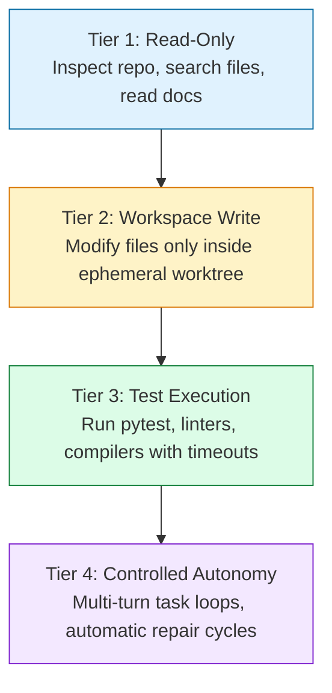

# Agentic Coding MVP & Benchmarking (M3–M4)

With local inference verified on AGX Thor, connect your Mac development environment to execute the **Agentic Coding MVP (M3)** and establish a **Systematic Benchmarking Suite (M4)**.

---

## 1. Phase M3 — Agentic Coding MVP on the Mac (Priority P0)

The MVP goal is simple: an AI agent running on your Mac uses Thor as its brain to autonomously diagnose a bug, write a patch, run tests, and output a clean Git diff.

### 1.1 Encrypted Tunneling

On your Mac, establish a background SSH tunnel forwarding local port `11500` to Thor's internal Ollama/vLLM port:

```bash
ssh -N -f -L 11500:127.0.0.1:11434 cc@thor-agx.local
```

Verify connectivity from your Mac:
```bash
curl -s http://127.0.0.1:11500/v1/models | jq .
```

### 1.2 Connecting OpenCode v2

OpenCode v2 natively supports local Ollama endpoints. Create `~/.config/opencode/config.json`:

```json
{
  "$schema": "https://opencode.ai/config.json",
  "model": "ollama/qwen3-coder:30b",
  "providers": {
    "ollama": {
      "settings": {
        "baseURL": "http://127.0.0.1:11500/v1"
      }
    }
  }
}
```

### 1.3 Connecting Claude Code

Because Claude Code uses the Anthropic Messages API, point it to the Ollama endpoint:

```bash
export ANTHROPIC_BASE_URL=http://localhost:11500
export ANTHROPIC_AUTH_TOKEN=ollama
claude
```

---

## 2. Progressive Permission Tiers

Do not grant an agent unrestricted write or terminal privileges on day one. Progress through 4 authorization levels:



---

## 3. The 6 MVP Acceptance Tests

To validate M3, create a dedicated test repository with intentional bugs and failing assertions. The agent must pass all 6 criteria **without manual intervention**:

- [ ] **1. Autonomous Analysis**: Discovers repository structure, identifies the entry point, and summarizes module boundaries.
- [ ] **2. Bug Localization**: Locates a deliberate off-by-one or edge-case bug based solely on a failing test report.
- [ ] **3. Surgical Implementation**: Writes a minimal patch modifying only the affected function; adds a regression test.
- [ ] **4. Test Execution & Repair**: Executes `pytest`, detects any remaining failure, adjusts the patch, and re-runs tests until 100% green.
- [ ] **5. Multi-File Refactoring**: Propagates a renamed interface or updated type signature across at least **three files** consistently.
- [ ] **6. Audit & Diff Generation**: Generates a standard `git diff` and a Markdown summary report explaining the rationale.

**Outcome of M3:** The core agentic coding loop works reliably end-to-end.

---

## 4. Phase M4 — Systematic LLM Benchmarking (Priority P1)

Do not rely on subjective impressions. Build an automated benchmark runner to evaluate model variants (e.g. Qwen3-Coder 30B vs. Qwen3-Coder-Next 80B vs. Qwen3.6 27B) across concrete metrics.

### 4.1 Key Performance Indicators (KPIs)

| Metric | Measurement Unit | Operational Impact |
|---|---|---|
| **TTFT (Time-to-First-Token)** | Seconds | Interactive responsiveness during live sessions |
| **Decode Speed** | Tokens / second | Completion velocity for code generation |
| **Prefill Speed** | Tokens / second | Ability to digest large repositories & multi-file context |
| **Memory Peak** | GB Unified Memory | Headroom margin under 128 GB ceiling |
| **Cache Hit Rate** | % tokens reused | Efficiency of agent multi-turn conversation loops |
| **Tool Call Success Rate** | % valid JSON arguments | Elimination of malformed tool-call retries |
| **Task Completion Rate** | % passed unit tests | Real-world problem-solving capability |

### 4.2 The 20-Task Benchmark Suite

Structure 20 reproducible test cases across 6 engineering categories:

| Domain | Test Count | Evaluation Rubric |
|---|---|---|
| **Python** | 4 tasks | Algorithm bugfix, asyncio race condition, CLI parser, typed model refactor |
| **C/C++** | 4 tasks | Memory leak fix (valgrind), CMake target linking, pointer bounds, header isolation |
| **Embedded STM32** | 3 tasks | HAL GPIO initialization, DMA buffer alignment, peripheral state machine |
| **Repository Refactor** | 3 tasks | Deprecate class across 5 files, split monolithic module into hexagonal layers |
| **Tool Calling Reliability** | 3 tasks | Complex nested JSON arguments, multi-tool parallel calls, handling tool errors |
| **Architecture Analysis** | 3 tasks | Generating Architecture Decision Records (ADRs), finding circular imports |

### 4.3 Model Decision Gate

Before a model is promoted to the default coding engine on Thor, it must satisfy:
1. **Tool-Call Compliance**: $\ge 90\%$ valid JSON schema calls.
2. **Task Completion**: $\ge 80\%$ green test results on simple and intermediate tasks.
3. **Stability**: Zero out-of-memory aborts during a sustained 64k token session.
