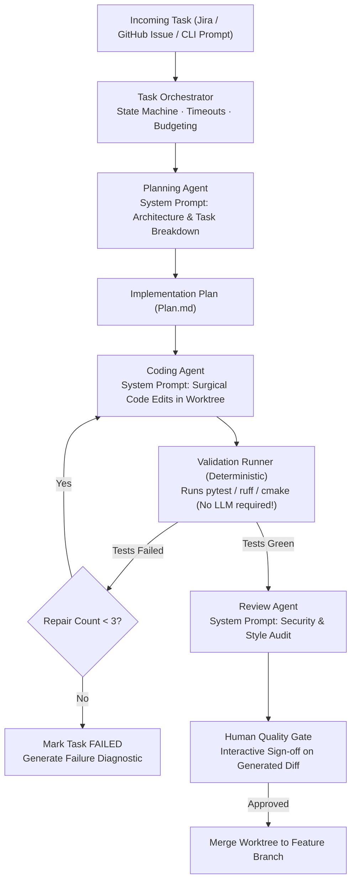

# Autonomous Execution & Git Worktree Isolation (M6)

In **Phase M6**, the platform evolves from interactive human-guided coding to controlled, autonomous task execution.

---

## 1. Specialist Agent Topology

You do not need five separate 80B models running in parallel. Instead, use a single high-performance model on AGX Thor that adopts distinct system prompts and permissions based on the role:



---

## 2. The Agent Task Lifecycle

Every task transitions through an explicit state machine with enforced timeout and cancellation rules:

```
CREATED
   │
   ▼
VALIDATED (Prompt & bounds checked)
   │
   ▼
PLANNED (Steps articulated)
   │
   ▼
IMPLEMENTING (Edits applied to worktree)
   │
   ▼
TESTING ───► FAILED
   │            │
   │            ▼
   │         REPAIR (Max 3 iterations)
   │            │
   ◄────────────┘
   │
   ▼
REVIEW (Architecture & security audit)
   │
   ▼
AWAITING_APPROVAL (Human operator sign-off)
   │
   ▼
COMPLETED
```

---

## 3. Git Worktree Isolation

Never allow an autonomous agent to execute directly in your active development directory. Instead, provision an ephemeral Git worktree for every task:

```bash
# 1. Create task-specific branch and isolated working directory
git worktree add ../agent-worktrees/task-104 -b agent/task-104

# 2. Run agent container mounted strictly to that worktree
docker run --rm \
  --name agent-task-104 \
  --network none \
  --memory 16g \
  --cpus 8 \
  -v /srv/agentic/worktrees/task-104:/workspace:rw \
  agent-runner:latest \
  --task-id task-104

# 3. Upon completion, inspect the isolated diff
git -C ../agent-worktrees/task-104 diff main

# 4. Clean up worktree after merge or rejection
git worktree remove ../agent-worktrees/task-104
```

---

## 4. Enforcement of Execution Guardrails

To prevent run-away agent loops or resource starvation, enforce strict limits:

| Protective Guardrail | Operational Limit | Enforcement Mechanism |
|---|---|---|
| **Max Agent Turns** | 20 tool calls per task | Orchestrator step counter |
| **Max Repair Attempts** | 3 attempts per failure category | State machine transition guard |
| **Tool Execution Timeout** | 60 seconds per shell command | Subprocess kill signal (`SIGKILL`) |
| **Filesystem Boundary** | Only mounted worktree directory | Docker rootless volume mount |
| **Network Egress** | Deny all outbound traffic | `--network none` (or allowlist for package mirrors) |
| **Git Push Permission** | Strictly disabled | Git credentials omitted from sandbox |
| **Secret Protection** | `.env` and API keys masked | Pre-execution regex filter |
| **Durable Audit Trail** | All prompts, tool calls, and diffs saved | JSONL event recorder in `/srv/agentic/artifacts/` |

---

## 5. Hexagonal Modularity for the Platform

When building the platform software (e.g. `thor-agentic-dev`), maintain strict hexagonal architecture boundaries:

```text
src/
├── core/                   # Pure entities: Task, Plan, Diff, AuditRecord (Zero I/O)
├── ports/                  # Interfaces: ModelGatewayPort, ToolAdapterPort, WorktreePort
├── adapters/               # Implementations:
│   ├── git/                # Git worktree and commit adapter
│   ├── model/              # Ollama / vLLM HTTP client
│   └── shell/              # Subprocess runner with timeout & secret masking
├── application/            # Orchestrator, State Machine, Repair Policy
└── quality/                # Quality Gates, Test Evaluation, Diff Scoring
```

This ensures that upgrading from Ollama to vLLM, or switching from Docker to firecracker microVMs, requires updating only a single adapter module without touching orchestration logic.
