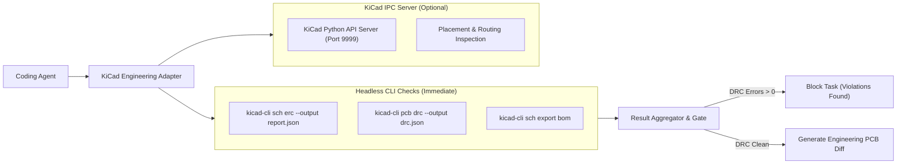
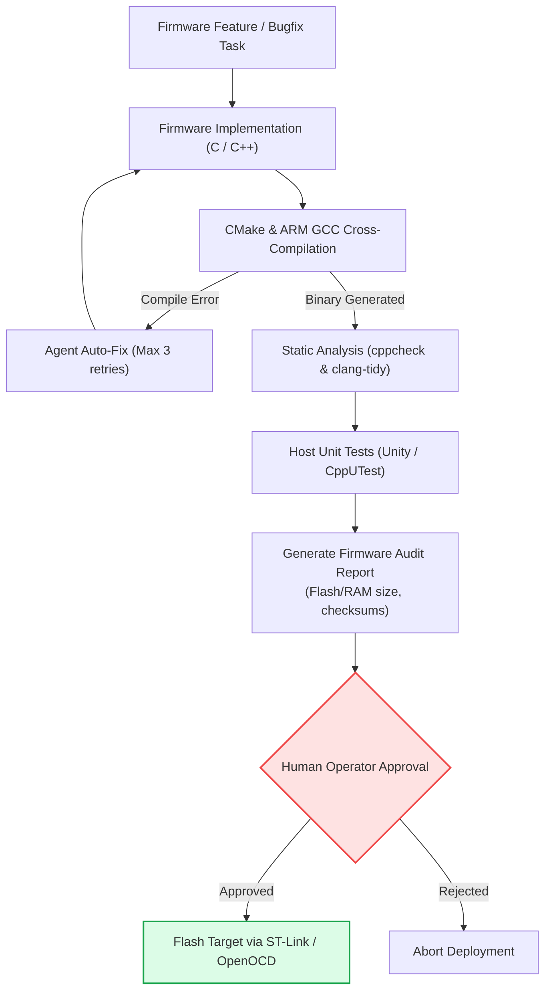

# Engineering Adapters: STM32, KiCad & ROS 2 (M7)

Phase M7 specializes the AGX Thor agentic platform for real-world hardware, firmware, and robotics engineering domains.

---

## 1. Engineering Adapter Matrix

Each engineering discipline is encapsulated in a dedicated tool adapter implementing a common interface:

| Domain | Underlying Toolchain | Automated Agent Capabilities | Safety Boundary |
|---|---|---|---|
| **Python** | pytest, Ruff, mypy | Bugfixes, refactoring, test execution, typing enforcement | Ephemeral worktree |
| **C/C++** | CMake, Ninja, Clang-Tidy | Cross-compilation, pointer validation, static analysis | Subprocess timeout |
| **STM32** | ARM GCC, CubeMX, OpenOCD | Firmware synthesis, register abstraction, build verification | **No auto-flash** |
| **KiCad** | KiCad CLI, Python IPC | Automated ERC & DRC checks, BoM diff generation | **No auto-order** |
| **ROS 2** | colcon, rclpy, rclcpp | Package building, node creation, QoS validation | Container isolation |
| **Documentation** | MkDocs Material, Mermaid | Architecture Decision Records (ADRs), API docs | Read/write docs dir |

---

## 2. KiCad PCB Adapter Architecture

Automating electronic hardware design requires separating headless CLI checks from stateful IPC (Inter-Process Communication) tools:



### Capabilities of `kicad_adapter`:
1. **Automated ERC Check**: Runs `kicad-cli sch erc` and parses violations into structured JSON.
2. **Automated DRC Check**: Runs `kicad-cli pcb drc` on the `.kicad_pcb` layout. Any clearance, trace width, or unrouted net error marks the task `FAILED`.
3. **Bill of Materials (BoM) Diff**: Detects added, removed, or modified components and generates an itemized diff table.
4. **Gerber Generation Gate**: Exporting fabrication Gerbers is permitted only upon human operator sign-off.

---

## 3. STM32 Embedded Firmware Pipeline

Firmware development on AGX Thor follows a strict verification pipeline where physical flashing is explicitly separated from building:



> [!CAUTION]
> **Zero Auto-Flash Rule**: The agent sandbox must not have access to USB device nodes (`/dev/bus/usb`) or debug probes. Flashing microcontrollers without an oscilloscope or current-limited bench power supply risks permanent hardware damage.

---

## 4. ROS & ROS 2 Robotics Containers

Robotics projects frequently suffer from library conflicts across ROS distributions. AGX Thor uses dedicated, isolated ARM64 containers:

```text
/srv/agentic/containers/ros/
├── ros2-jazzy/             # Ubuntu 24.04 ARM64 + ROS 2 Jazzy
│   └── Dockerfile
└── ros2-iron/              # Ubuntu 22.04 ARM64 + ROS 2 Iron
    └── Dockerfile
```

### Architecture Rules for ROS Integration:
1. **Never Mix Distributions**: ROS 1 (Noetic) and ROS 2 environments must never share Python virtual environments or system paths.
2. **ARM64 Native Packages**: Because AGX Thor is an ARM64 system, verify that all external ROS drivers (e.g. LiDAR, depth cameras, CAN transceivers) provide `aarch64` binaries or compile from source.
3. **Automated Colcon Testing**:
   ```bash
   colcon build --symlink-install --cmake-args -DCMAKE_BUILD_TYPE=RelWithDebInfo
   colcon test --event-handlers console_direct+
   colcon test-result --verbose
   ```
4. **QoS Profile Validation**: Agents modifying pub/sub communication must explicitly declare QoS reliability and durability profiles to prevent silent dropped messages.
