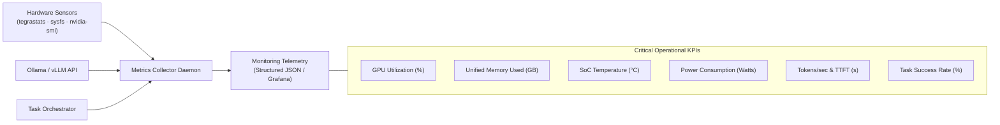

# Operations, Monitoring & Implementation Brief (M8)

Phase M8 hardens the AGX Thor platform for reliable 24/7 autonomous operation and provides a formal implementation brief to guide future coding agents.

---

## 1. Observability & Telemetry Dashboard

A local Python telemetry daemon monitors system health and streams metrics to lightweight logging endpoints:



### Telemetry Thresholds

| Metric | Target Normal | Warning Threshold | Critical Action |
|---|---|---|---|
| **Unified Memory** | $\le 85\text{ GB}$ | $105\text{ GB}$ | Pause new tasks; evict idle KV-caches |
| **SoC Temperature** | $\le 65^\circ\text{C}$ | $80^\circ\text{C}$ | Ramp active cooling fan to 100% |
| **Power Consumption** | $\le 75\text{ W}$ | $110\text{ W}$ | Cap parallel batch concurrency |
| **Consecutive Task Fails** | 0 | 3 failures | Lock orchestrator; request human review |

---

## 2. Platform Repository Blueprint (`thor-agentic-dev`)

For clean version control and isolation from production projects, the entire infrastructure lives in a dedicated repository:

```text
thor-agentic-dev/
├── README.md                      # Platform overview & quickstart
├── AGENTS.md                      # Rules of engagement for AI agents
├── .env.example                   # Endpoint URLs and local paths
├── config/
│   ├── models.yaml                # Model definitions, context sizes, quantizations
│   ├── agents.yaml                # Specialist prompts, tool allocations, timeouts
│   ├── permissions.yaml           # Security boundaries and approval gates
│   └── benchmarks.yaml            # 20-task benchmark configurations
├── infrastructure/
│   ├── docker/                    # JetPack 7.x Dockerfiles for Thor
│   ├── systemd/                   # Service definitions for auto-restart
│   ├── networking/                # Firewall, SSH, and tunnel configurations
│   └── monitoring/                # Telemetry collector and logging scripts
├── src/
│   ├── core/                      # Pure domain models (Task, Plan, Diff, Audit)
│   ├── orchestration/             # State machine & repair loop controller
│   ├── model_gateway/             # Unified Ollama / vLLM API client
│   ├── execution/                 # Docker worktree executor
│   ├── adapters/                  # Tool implementations (git, shell, python, stm32, kicad, ros)
│   ├── quality/                   # Automated diff evaluation and test parsers
│   └── observability/             # Health checks and Prometheus/JSON metrics
├── scripts/
│   ├── audit.sh                   # Phase M0 hardware & environment probe
│   ├── install.sh                 # Phase M1 storage & permissions bootstrap
│   ├── start.sh                   # Service launch coordinator
│   └── healthcheck.sh             # API and GPU liveness probe
├── benchmarks/                    # Datasets, runners, and historical results
├── tests/                         # Unit, integration, and security test suites
└── docs/                          # Architecture, installation, and runbooks
```

---

## 3. Formal Implementation Brief for Coding Agents

When deploying an autonomous coding agent (such as Claude Code, OpenCode, or Codex) to build or modify this platform, use the following formal brief:

```markdown
# Implementation Brief — Thor Agentic Development Platform

## Objective
Build a reproducible, secure, local-first agentic coding platform using an NVIDIA Jetson AGX Thor as the primary LLM inference server.

The initial execution architecture is hybrid:
- NVIDIA Jetson AGX Thor: GPU inference, model storage, API serving, metrics.
- macOS development host: IDE, OpenCode/Claude Code, repositories, local tools.
- Isolated Linux execution containers: builds, tests, and controlled automation.

## Mandatory Implementation Sequence
1. Audit the current Thor hardware and operating system (M0).
2. Validate JetPack, CUDA, Docker, and GPU runtime compatibility (M1).
3. Implement persistent storage, SSH-based access, and health checks (M1).
4. Deploy a supported Ollama inference environment (M2).
5. Validate Qwen3-Coder 30B with real GPU monitoring (M2).
6. Connect OpenCode / Claude Code over a secure SSH tunnel (M3).
7. Create deterministic end-to-end coding-agent tests (M3).
8. Implement a repeatable model benchmarking framework (M4).
9. Evaluate vLLM and optimized model variants with Prefix Caching (M5).
10. Add isolated agent execution and engineering adapters (M6–M7).
11. Implement monitoring, recovery, and operational documentation (M8).

## Architecture Constraints
- Separate domain logic, orchestration, infrastructure, and adapters.
- Use explicit interfaces for model inference and tool execution.
- Never mix incompatible JetPack / CUDA environments.
- Never expose unauthenticated inference APIs to the public internet.
- Never grant agents unrestricted host filesystem or Docker socket access.
- Never auto-flash hardware, release fabrication files, or push protected branches.

## Quality Requirements
- Automated tests where technically applicable.
- Actual execution evidence rather than verbal success claims.
- Explicit PASS, FAIL, or BLOCKED status for every milestone.
- An actionable rollback or recovery procedure for every infrastructure change.
```

---

## 4. Recommended Sprint 1 Plan (M0 to M3)

Focus strictly on **Sprint 1 (Milestones M0 to M3)** before investing effort in multi-agent orchestration or complex GPU optimizations:

- [ ] **Step 1**: Run hardware and system audit on AGX Thor (`audit.sh`).
- [ ] **Step 2**: Verify JetPack 7.x, CUDA 12.8+, and Docker NVIDIA runtime.
- [ ] **Step 3**: Provision persistent storage under `/srv/agentic/`.
- [ ] **Step 4**: Lock down SSH key authentication; disable root and password logins.
- [ ] **Step 5**: Launch the Ollama Jetson container with GPU offload verified.
- [ ] **Step 6**: Pull `qwen3-coder:30b` and confirm 100% GPU offload with `nvidia-smi`.
- [ ] **Step 7**: Test inference latency with a test prompt over curl.
- [ ] **Step 8**: Establish an encrypted SSH tunnel from Mac (`localhost:11500` ➔ `127.0.0.1:11434`).
- [ ] **Step 9**: Configure OpenCode v2 or Claude Code on Mac pointing to the tunnel.
- [ ] **Step 10**: Execute the 6-step MVP test in a designated test repository.
