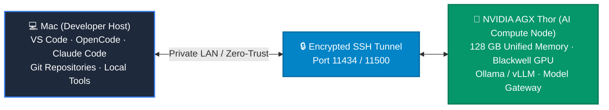

# Module 08 — NVIDIA Jetson AGX Thor Agentic Platform

**Goal:** Turn an NVIDIA Jetson AGX Thor (Blackwell architecture, 128 GB Unified Memory) into a local, high-throughput AI inference and autonomous agentic engineering platform while preserving development safety on your Mac.

| # | Lesson / Chapter | Time |
|---|---|---|
| 1 | [Target Architecture & Hybrid Topology](01-target-architecture.md) | 15 min |
| 2 | [9-Phase Roadmap & Release Gates (M0–M8)](02-roadmap-and-milestones.md) | 20 min |
| 3 | [Hardware Audit & Secure Infrastructure (M0–M1)](03-hardware-audit-and-infrastructure.md) | 15 min |
| 4 | [Local Inference: Ollama, vLLM & Prefix Caching (M2 & M5)](04-local-inference-ollama-vllm.md) | 25 min |
| 5 | [Agentic Coding MVP & Benchmarking (M3–M4)](05-agentic-coding-mvp.md) | 20 min |
| 6 | [Autonomous Execution & Git Worktree Isolation (M6)](06-autonomous-execution-and-worktrees.md) | 20 min |
| 7 | [Engineering Adapters: STM32, KiCad & ROS 2 (M7)](07-engineering-adapters.md) | 25 min |
| 8 | [Operations, Monitoring & Implementation Brief (M8)](08-monitoring-operations-and-brief.md) | 15 min |

---

## Executive Overview

The **NVIDIA Jetson AGX Thor** represents a generational leap for local and edge AI engineering. Powered by NVIDIA's Blackwell GPU architecture, unified LPDDR5X memory (128 GB), and advanced tensor cores supporting native **FP4 and FP8 precision**, Thor can host 30B to 80B parameter coding models entirely locally without relying on external cloud APIs.

---

## Why a Hybrid Architecture?

Running both heavy LLM inference and resource-intensive build pipelines (such as CMake, Ninja, GCC, and ROS 2 builds) on a single embedded device can overwhelm unified memory and trigger the Linux Out-Of-Memory (OOM) killer.

By adopting a **hybrid topology**:
- **Your Mac** acts as the primary developer interface, hosting the IDE, local Git repositories, and tool execution.
- **AGX Thor** acts as an uncompromised, high-speed neural compute node, serving models via Ollama or vLLM over a zero-trust SSH tunnel.
- **Isolated Containers** (running on Mac or Thor) execute automated builds and tests inside isolated Git worktrees.

---

## The 9-Phase Roadmap at a Glance

```mermaid
gantt
    title Thor Platform Milestones (M0 to M8)
    dateFormat  X
    axisFormat Day %d
    
    section Foundation
    M0 Hardware & OS Audit       :m0, 0, 1
    M1 Secure Infrastructure     :m1, 1, 3
    M2 Local Ollama Inference    :m2, 3, 5
    M3 Agentic Coding MVP        :m3, 5, 8
    
    section Optimization
    M4 Model Benchmarking (30B vs 80B) :m4, 8, 11
    M5 vLLM & Prefix Caching     :m5, 11, 15
    
    section Autonomy & Domain
    M6 Autonomous Git Worktrees  :m6, 15, 19
    M7 STM32 / KiCad / ROS Adapters :m7, 19, 23
    M8 Monitoring & Hardening    :m8, 23, 26
```

---

## Key Invariants & Safety Principles

1. **Inference and Execution Are Separated**: The LLM does not get an unrestricted host shell. All actions flow through structured tool adapters.
2. **Fail-Closed Safety Gates**: Destructive operations (hardware flashing, PCB fabrication release, Git branch pushes) require explicit human approval.
3. **Task Isolation via Git Worktrees**: Every task executes in an ephemeral Git worktree (`git worktree add ../task-xxx`), keeping the main branch untouched until review.
4. **Interchangeable Inferenz-Backends**: Start with Ollama for zero-friction setup; transition to vLLM with Prefix Caching for 5x–10x multi-turn agent acceleration.
5. **Measurable Verification**: An agent cannot pass its own task simply by declaring success; passing unit tests and clean linter outputs are non-negotiable.
