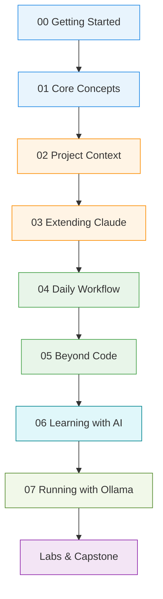

# Claude Code Complete Course & Architecture Guide

This comprehensive curriculum takes you from a fresh installation to an advanced, production-grade Claude Code workspace backed by local or cloud models served by Ollama.

The course seamlessly integrates **step-by-step progressive lessons** with **in-depth architecture deep dives**, matching hands-on labs, and production reference guides.

---

## Learning Path



---

## Course Modules (00 – 07)

| Level | Module | Progressive Lessons & Integrated Deep Dives |
|---|---|---|
| 🟦 **Beginner** | [**00 Getting Started**](00-getting-started/README.md) | Where Claude runs (Desktop, CLI, Web), plans & usage limits, desktop UI tour. |
| 🟦 **Beginner** | [**01 Core Concepts**](01-core-concepts/README.md) | Prompting mechanics, models, effort levels, permission modes, plan mode.<br>• *Deep Dives:* [Claude 101: API Fundamentals](01-core-concepts/06-claude-101-api-fundamentals.md), [AI Fluency Framework](01-core-concepts/07-ai-fluency-framework.md). |
| 🟧 **Intermediate** | [**02 Project Context**](02-project-context/README.md) | `CLAUDE.md` standing instructions, memory system, `.claude/settings.json`, referencing context with `@`. |
| 🟧 **Intermediate** | [**03 Extending Claude**](03-extending-claude/README.md) | Skills, subagents, MCP servers, event hooks, plugins & mods.<br>• *Deep Dives:* [MCP Expert Guide](03-extending-claude/06-mcp-expert-guide.md), [Advanced MCP](03-extending-claude/07-mcp-advanced-patterns.md), [Agent Skills Guide](03-extending-claude/08-agent-skills-guide.md), [Subagents Architecture](03-extending-claude/09-subagents-architecture.md), [Skills Reference](03-extending-claude/10-skills-deep-dive.md). |
| 🟩 **Advanced** | [**04 Daily Workflow**](04-daily-workflow/README.md) | Context management (`/compact`, `/clear`), `/rewind`, parallel sessions & worktrees, code review, routines.<br>• *Deep Dive:* [Claude Code in Action Complete Guide](04-daily-workflow/06-claude-code-in-action.md). |
| 🟩 **Advanced** | [**05 Beyond Code**](05-beyond-code/README.md) | Projects & memory, connectors, Cowork & scheduled tasks, Claude Design → Claude Code, building custom tools.<br>• *Deep Dive:* [Building with Claude API & RAG](05-beyond-code/06-building-with-claude-api-and-rag.md). |
| 🟦 **Applied** | [**06 Learning with AI**](06-learning-with-ai/README.md) | Collect → Understand → Own framework: Learn any technical topic fast with Claude + a research notebook, and maintain a permanent archive. |
| 🟧 **Alternative** | [**07 Running with Ollama**](07-running-with-ollama/README.md) | Connect Claude Code to local hardware or Ollama Cloud, 64k+ context requirements, headless CI (`--yes`), `/loop`, Telegram channels, Storybook screenshot loops. |

---

## Hands-on Labs & Capstone

Each module is paired with a concrete hands-on lab in [`labs/`](labs/README.md):

| Lab | Name | Goal |
|---|---|---|
| [**Lab 01**](labs/lab-01-first-project.md) | First Project | Open a folder, run initial inspection prompt, explore workspace |
| [**Lab 02**](labs/lab-02-plan-mode.md) | Plan Mode | Use plan mode to design a refactor before letting Claude write code |
| [**Lab 03**](labs/lab-03-claude-md.md) | `CLAUDE.md` | Run `/init` to generate standing project instructions and test enforcement |
| [**Lab 04**](labs/lab-04-settings.md) | Settings & Permissions | Configure `.claude/settings.json` permissions (allow/ask/deny) |
| [**Lab 05**](labs/lab-05-skill.md) | Creating a Skill | Build and test a custom `SKILL.md` (e.g. commit-message generator) |
| [**Lab 06**](labs/lab-06-subagent.md) | Creating a Subagent | Create a specialist reviewer agent with restricted tools and custom prompt |
| [**Lab 07**](labs/lab-07-hook.md) | Event Hooks | Add a desktop notification or secret-blocking hook to `settings.json` |
| [**Lab 08**](labs/lab-08-parallel.md) | Parallel Sessions | Run parallel git worktrees to develop two features simultaneously |
| [**Lab 09**](labs/lab-09-learning-workflow.md) | Learning Workflow | Build a research archive using the Collect → Understand → Own method |
| [**Lab 10**](labs/lab-10-ollama.md) | Running with Ollama | Launch Claude Code backed by local models served by Ollama |
| [**Capstone**](labs/capstone.md) | Full Workspace Build | Synthesize skills, subagents, hooks, MCP, and Ollama into a complete project |

---

## Interactive Progress Dashboard

The repository includes an interactive, browser-based tracker: [`progress-dashboard.html`](https://github.com/CagriCatik/claude-ollama-coder/blob/main/progress-dashboard.html).

Open it locally in your browser:
```bash
open progress-dashboard.html       # macOS
xdg-open progress-dashboard.html   # Linux
start progress-dashboard.html      # Windows
```

---

## Reference Guides

- [**Unified Reference Cheatsheet**](unified-cheatsheet.md) — Production habits, token budgets, prompt caching, and tool schemas.
