# Labs

Hands-on exercises. Labs 01–08 take 15–30 minutes each and build on one another, using one practice project throughout: **`log-summarizer`** — a small CLI that turns a log file into a Markdown summary. (Use any language you like; Python is assumed in examples.) Lab 09 is standalone: you learn a real topic of your choice.

```mermaid
flowchart LR
    L1[01 First project] --> L2[02 Plan mode]
    L2 --> L3[03 CLAUDE.md]
    L3 --> L4[04 settings.json]
    L4 --> L5[05 Skill]
    L5 --> L6[06 Subagent]
    L6 --> L7[07 Hook]
    L7 --> L8[08 Parallel work]
    L8 --> L9[09 Learning workflow]
    L9 --> L10[10 Ollama]
    L10 --> CAP[🏆 Capstone]
```

| Lab | Practises | Module |
|---|---|---|
| [01 First project](lab-01-first-project.md) | Install, open folder, first prompt | 00 |
| [02 Plan mode](lab-02-plan-mode.md) | Plan → questions → build | 01 |
| [03 CLAUDE.md](lab-03-claude-md.md) | `/init`, editing, testing it | 02 |
| [04 settings.json](lab-04-settings.md) | allow/ask/deny | 02 |
| [05 Skill](lab-05-skill.md) | Project vs. global skill | 03 |
| [06 Subagent](lab-06-subagent.md) | Delegation & context | 03 |
| [07 Hook](lab-07-hook.md) | Event automation | 03 |
| [08 Parallel work](lab-08-parallel.md) | Worktrees, `/compact`, `/rewind`, `/code-review` | 04 |
| [09 Learning workflow](lab-09-learning-workflow.md) | Collect → Understand → Own on a real topic | 06 |
| [10 Ollama](lab-10-ollama.md) | Local models, launch, headless `--yes`, `/loop` | 07 |
| [🏆 Capstone](capstone.md) | Everything together | all |

**Progress tracker** — tick as you go:

- [ ] Lab 01
- [ ] Lab 02
- [ ] Lab 03
- [ ] Lab 04
- [ ] Lab 05
- [ ] Lab 06
- [ ] Lab 07
- [ ] Lab 08
- [ ] Lab 09
- [ ] Lab 10
- [ ] Capstone
