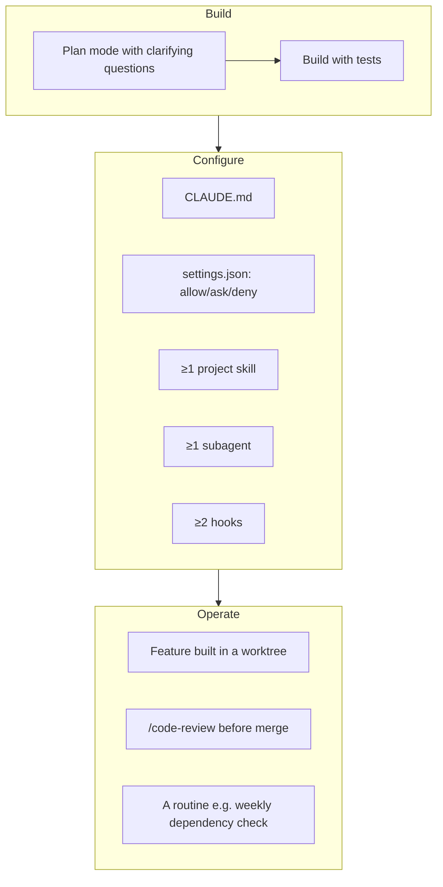

# 🏆 Capstone — A Fully Configured Project

Build a new small tool **from scratch** and set up the project the way a professional team would. Suggested topic: a *test-report dashboard* that turns JUnit XML files into a static HTML page — or pick something from your own work.

## Requirements

## Checklist
- [ ] Started in **Plan** mode; plan reviewed and revised once
- [ ] `CLAUDE.md` with overview, commands, architecture, rules (< 150 lines)
- [ ] `.claude/settings.json` with sensible allow/ask/deny
- [ ] One project skill (e.g. `release-notes`)
- [ ] One subagent (e.g. read-only `reviewer`)
- [ ] Two hooks (e.g. format on edit + notify on stop)
- [ ] One MCP server connected *or* a documented `.mcp.json` (e.g. GitHub)
- [ ] One feature developed in a worktree and merged
- [ ] `/code-review` run and at least one finding fixed
- [ ] One routine created
- [ ] A double-clickable launcher or simple CLI so the tool works **without Claude**

## Self-assessment

| Question | ✔ |
|---|---|
| Can a teammate clone the repo and get the same Claude behavior? | |
| Does a fresh session understand the project without exploring? | |
| Are secrets impossible for Claude to read? | |
| Could you explain each file in `.claude/` to someone else? | |

Use [`examples/starter-project/`](https://github.com/CagriCatik/claude-ollama-coder/tree/main/examples/starter-project/) as a reference — not as a copy.
