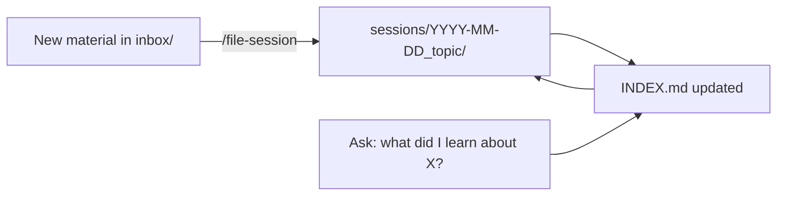

# Learning Archive — Template

A ready-to-copy version of the archive from [Module 06 · Own](../../06-learning-with-ai/04-own.md). It is filled with one example session.

```text
learning-archive/
├── CLAUDE.md                 ← filing rules Claude follows in this folder
├── INDEX.md                  ← top-level index (for AI and humans)
├── inbox/                    ← unsure items wait here
├── templates/
│   ├── research-brief.md     ← Stage 1 context brief
│   └── SESSION.template.md
├── .claude/skills/file-session/SKILL.md   ← optional: /file-session
└── sessions/
    └── 2026-10-24_ai-agent-engineering/
        ├── SESSION.md
        ├── questions.md
        └── artifacts/
```



**Usage:** copy this folder somewhere on your computer, give Claude access to it, and delete the example session once you've archived your first real one.
