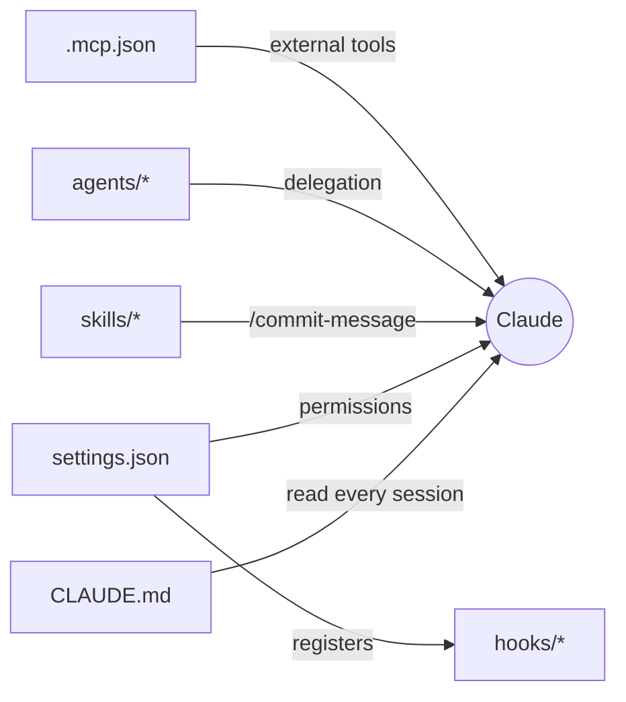

# Starter Project — a Fully Configured `.claude/` Setup

A reference layout showing every configuration file from the course in one place. Copy the parts you need into your own repo.

```text
starter-project/
├── CLAUDE.md                         ← standing instructions (lesson 02-1)
├── .mcp.json                         ← shared MCP servers (lesson 03-3)
├── .gitignore
├── src/
│   └── CLAUDE.md                     ← nested, folder-specific rules
└── .claude/
    ├── settings.json                 ← permissions + hooks (lessons 02-3, 03-4)
    ├── settings.local.example.json   ← template for personal overrides
    ├── skills/
    │   └── commit-message/SKILL.md   ← lesson 03-1
    ├── agents/
    │   ├── code-reviewer.md          ← lesson 03-2
    │   └── test-runner.md
    └── hooks/
        ├── notify.sh                 ← Stop: desktop notification (macOS/Linux)
        ├── notify.ps1                ← Stop: desktop notification (Windows)
        └── block-secrets.sh          ← PreToolUse: guardrail
```



> Make hook scripts executable: `chmod +x .claude/hooks/*.sh`
