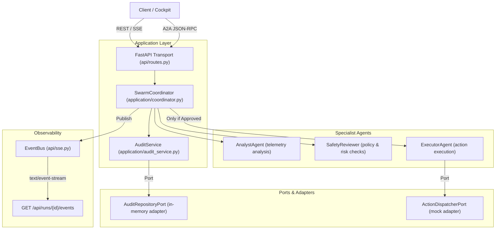
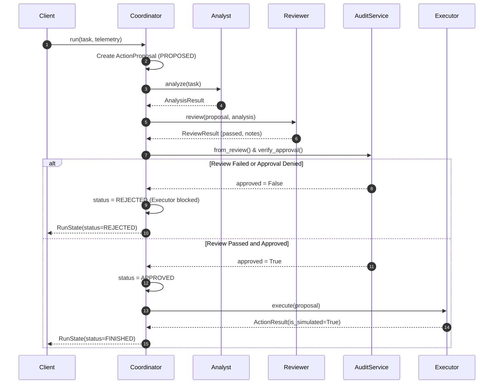

# Swarm Coordinator — Hexagonal Micro-Swarm Service

A production-grade Python reference implementation of a multi-agent micro-swarm demonstrating **hexagonal architecture**, **fail-closed pre-execution audit gating**, **symmetric A2A JSON-RPC messaging**, and **real-time SSE event streaming**.

Built strictly following the [`skills/agentswarm-engineer/SKILL.md`](../../skills/agentswarm-engineer/SKILL.md) specification and verified with Claude Code (`beam:cloud`).

---

## Features

- **Hexagonal Architecture (Ports & Adapters)**:
  - `domain/`: Pure Pydantic v2 entities (`Task`, `ActionProposal`, `AuditRecord`, `RunState`, `SwarmEvent`), strictly decoupled from frameworks and transport.
  - `ports/`: Abstract protocols for action dispatchers and audit repositories.
  - `adapters/`: In-memory thread-safe audit store and mock action dispatcher.
  - `application/`: Coordinated business workflows and safety audit policies.
  - `api/`: Transport boundaries for FastAPI REST, SSE streaming, and A2A JSON-RPC.
- **Fail-Closed Pre-Execution Audit Gate**:
  - Implements the strict pipeline: `propose ➔ analyze ➔ review/audit ➔ approve ➔ execute`.
  - Audit defaults strictly fail closed (`authorized=False`, `signoff_approved=False`).
  - If review fails or approval is denied, the proposal transitions to `REJECTED` and the executor is **never invoked**.
- **Explicit Simulation Provenance**:
  - `MockActionDispatcher` stamps all outputs with `is_simulated=True` and `status="simulated"`.
  - Avoids false claims of verified infrastructure mutations.
- **Symmetric A2A Protocol**:
  - Standards-compliant JSON-RPC 2.0 `SendMessage` handler with `{"message": {"parts": [{"text": "..."}]}}` payload support.
  - Service discovery via `GET /.well-known/agent-card.json`.
- **Real-Time Cockpit Telemetry (SSE)**:
  - Event streaming via `GET /api/runs/{id}/events` emitting typed lifecycle events: `component_started`, `review_completed`, `execution_completed`, and terminal `run_finished`.
- **100% Test Coverage**:
  - Unit tests for domain immutability and fail-closed audit gates.
  - Contract tests for A2A JSON-RPC symmetry and Agent Card discovery.
  - Integration tests for FastAPI endpoints and streaming SSE listeners.

---

## Quick Start

### Installation

```bash
cd examples/swarm-coordinator
pip install -e ".[dev]"
```

### Running the Server

```bash
uvicorn swarm_coordinator.api.routes:app --reload --port 8000
```

Server runs at `http://localhost:8000`.

### Running Tests & Linting

```bash
pytest tests/ -v
ruff check src tests
```

---

## Architecture



---

## Safety Model & Execution Gate



---

## API Reference

### 1. Create a Swarm Run

```http
POST /api/runs
Content-Type: application/json

{
  "input": "Scale deployment api-server to 3 replicas",
  "telemetry": {
    "risk_level": "low",
    "requirements_met": true
  }
}
```

**Response (200 OK):**
```json
{
  "run_id": "8f8b65e9-4e7a-4282-9988-8e68cf0a2d2f",
  "status": "finished",
  "task": {
    "task_id": "b3ad3cb2-63ec-4993-80b6-1eb8aa8556f0",
    "description": "Scale deployment api-server to 3 replicas"
  },
  "proposals": [
    {
      "action": "execute_task",
      "target": "Scale deployment api-server to 3 replicas",
      "status": "simulated",
      "is_simulated": true
    }
  ],
  "result": {
    "status": "simulated",
    "is_simulated": true,
    "details": {
      "adapter": "MockActionDispatcher",
      "note": "No infrastructure mutation performed; result is simulated."
    }
  }
}
```

### 2. Stream Live Events (SSE)

```http
GET /api/runs/8f8b65e9-4e7a-4282-9988-8e68cf0a2d2f/events
Accept: text/event-stream
```

**Stream output:**
```
event: component_started
data: {"event": "component_started", "run_id": "...", "data": {"component": "coordinator"}, "timestamp": "..."}

event: component_started
data: {"event": "component_started", "run_id": "...", "data": {"component": "analyst"}, "timestamp": "..."}

event: review_completed
data: {"event": "review_completed", "run_id": "...", "data": {"passed": true, "notes": "..."}, "timestamp": "..."}

event: execution_completed
data: {"event": "execution_completed", "run_id": "...", "data": {"status": "simulated", "is_simulated": true}, "timestamp": "..."}

event: run_finished
data: {"event": "run_finished", "run_id": "...", "data": {"status": "finished"}, "timestamp": "..."}
```

### 3. A2A JSON-RPC 2.0 SendMessage

```http
POST /
Content-Type: application/json

{
  "jsonrpc": "2.0",
  "id": "req-001",
  "method": "SendMessage",
  "params": {
    "message": {
      "message_id": "msg-123",
      "role": "ROLE_USER",
      "parts": [
        {"text": "Perform system diagnostic and health verification"}
      ]
    }
  }
}
```

**Response (200 OK):**
```json
{
  "jsonrpc": "2.0",
  "id": "req-001",
  "result": {
    "run_id": "01948572-c51d-7201-8b01-081cfc6731ba",
    "status": "finished",
    "result": {
      "status": "simulated",
      "is_simulated": true,
      "details": {
        "adapter": "MockActionDispatcher"
      }
    }
  }
}
```

### 4. Agent Card Discovery

```http
GET /.well-known/agent-card.json
```

**Response (200 OK):**
```json
{
  "name": "swarm-coordinator",
  "description": "Micro-swarm coordinator with pre-execution audit gate",
  "url": "http://localhost:8000",
  "version": "0.1.0",
  "protocolVersion": "0.3.0",
  "capabilities": {
    "streaming": true,
    "pushNotifications": false
  },
  "defaultInputModes": ["text"],
  "defaultOutputModes": ["text", "application/json"],
  "skills": [
    {
      "name": "coordinate",
      "description": "Coordinate a run"
    }
  ]
}
```

---

## Fail-Closed Audit Gate Invariants

1. **Deny-by-default**: Default audit records require explicit affirmative approval (`authorized=True` AND `signoff_approved=True`).
2. **Review First**: Reviewer evaluation precedes any execution step.
3. **Execution Block**: If `requirements_met: false` or `risk_level: "high"`, the review fails (`passed=False`), proposal transitions to `REJECTED`, and the executor is never invoked.
4. **Audit Immutability**: All reviews and proposals produce durable audit records recorded in the audit repository before state transitions are finalized.