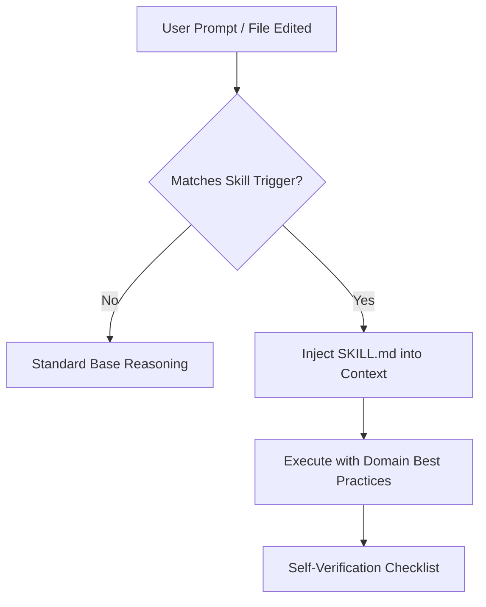

# Claude Code Agent Skills: Complete Authoring & Architecture Guide

This directory contains standardized, conforming **Agent Skills** for [Claude Code](https://claude.ai/code) and AI coding agents adhering to the open [Anthropic Agent Skills specification](https://agentskills.io).

---

## Table of Contents

1. [What Are Agent Skills?](#what-are-agent-skills)
2. [Skills vs. CLAUDE.md vs. Subagents](#skills-vs-claudemd-vs-subagents)
3. [The Progressive Disclosure Lifecycle](#the-progressive-disclosure-lifecycle)
4. [Directory & File Specification](#directory--file-specification)
5. [YAML Frontmatter Schema](#yaml-frontmatter-schema)
6. [Writing High-Quality Skill Instructions](#writing-high-quality-skill-instructions)
7. [Step-by-Step: Creating a New Skill](#step-by-step-creating-a-new-skill)
8. [Automated Validation](#automated-validation)
9. [Skills Catalog in This Repository](#skills-catalog-in-this-repository)
10. [Marketplace & Plugin Distribution](#marketplace--plugin-distribution)

---

## 1. What Are Agent Skills?

An **Agent Skill** is a modular package of domain-specific instructions, mental models, patterns, and deterministic scripts that AI agents load **dynamically on demand**.

Instead of stuffing thousands of lines of instructions into a permanent system prompt (which degrades model focus and burns tokens), skills remain dormant until a matching user task enters scope.



---

## 2. Skills vs. CLAUDE.md vs. Subagents

| Mechanism | Scope | When Loaded | Best Used For |
|---|---|---|---|
| **`CLAUDE.md`** | Global project | Loaded on every session start | Universal repo facts, build commands, repository-wide coding conventions. |
| **Agent Skills (`SKILL.md`)** | Conditional | Loaded only when trigger conditions match | Domain-specific procedures, API standards, framework guidelines (e.g. ROS2, Modelfiles, MCP). |
| **Subagents** | Isolated process | Spawned on demand | Long-running background research, parallel workflows, separate context spaces. |

---

## 3. The Progressive Disclosure Lifecycle

To optimize context window budget and inference latency, skills operate in three distinct phases:

1. **Discovery (Session Startup):**
   Claude Code scans available skills and loads *only* the `name` and `description` from the YAML frontmatter (~50–100 tokens per skill).
2. **Activation (Intent Matching):**
   When the user's prompt, command, or file context matches a skill's `description` (or when invoked directly via slash command, e.g. `/mcp-builder`), Claude Code reads the full `SKILL.md` body into context.
3. **Deep Execution (On-Demand References & Scripts):**
   If the task requires deep specifications or deterministic execution, Claude accesses subdirectories:
   - `references/`: Detailed specifications, catalogs, or tables loaded only when needed.
   - `scripts/`: Executable Bash/Python scripts executed directly via tool calling without leaking script source code into the prompt window.

---

## 4. Directory & File Specification

Each skill lives in its own dedicated directory:

```text
skills/my-skill-name/
├── SKILL.md                 # REQUIRED: Frontmatter + Markdown instructions
├── scripts/                 # OPTIONAL: Deterministic helper scripts (Python, Bash)
│   └── validate_input.py
├── references/              # OPTIONAL: In-depth reference docs and schemas
│   └── api_spec.md
└── assets/                  # OPTIONAL: Templates, icons, mock data
    └── template.json
```

### Discovery Locations

Claude Code discovers skills from the following standard locations:
* **Project Level:** `.claude/skills/<skill-name>/` or `skills/<skill-name>/` (checked into git).
* **User Level:** `~/.claude/skills/<skill-name>/` (available across all projects on your machine).
* **Plugin Marketplace:** Configured via `.claude-plugin/marketplace.json`.

---

## 5. YAML Frontmatter Schema

Every `SKILL.md` file **must** begin with a YAML frontmatter block enclosed by `---`:

```yaml
---
name: my-skill-name
description: Clear, action-oriented trigger description. Use when doing X, working with files Y, or troubleshooting error Z.
license: MIT
compatibility: Python >= 3.10, Claude Code
metadata:
  author: claude-ollama-coder
  version: "1.0.0"
---
```

### Field Constraints

| Field | Required | Constraints & Rules |
|---|---|---|
| **`name`** | **Yes** | Max 64 characters. Lowercase alphanumeric characters (`a-z`, `0-9`) and single hyphens (`-`). **Must match the parent directory name exactly**. |
| **`description`** | **Yes** | Max 1024 characters. Crucial for automated triggering. Must explicitly explain *what* the skill does and *when* Claude should activate it (`Use when...`). |
| **`license`** | No | License identifier (e.g., `MIT`, `Apache-2.0`). |
| **`compatibility`** | No | Max 500 characters. Environment prerequisites (e.g. `Ollama 0.4+, Python >= 3.10`). |
| **`metadata`** | No | Arbitrary key-value mapping (e.g. `version`, `author`). |
| **`allowed-tools`** | No | Space-separated list of pre-approved tools. |

---

## 6. Writing High-Quality Skill Instructions

Follow these principles when authoring the markdown body:

1. **Be Imperative and Action-Oriented:**
   Write direct instructions ("Do X, avoid Y") rather than generic essays. Claude will follow these guidelines verbatim.
2. **Provide "Good vs Bad" Patterns:**
   LLMs learn effectively from contrasting examples. Show the recommended pattern alongside the common anti-pattern.
3. **Include a Self-Verification Checklist:**
   Always conclude the skill with a checklist (`- [ ]`). Claude uses this to self-evaluate its work before reporting success.
4. **Define Trigger Boundaries:**
   Include explicit `When to Use This Skill` and `When NOT to Use` sections to prevent false-positive triggering.

---

## 7. Step-by-Step: Creating a New Skill

### Step 1: Duplicate the Template
```bash
cp -r skills/_template skills/my-new-skill
```

### Step 2: Edit `skills/my-new-skill/SKILL.md`
1. Update `name: my-new-skill` in the frontmatter.
2. Write a tight `description:` starting with `Use when...`.
3. Fill in the sections: Purpose, When to Use, Core Principles, Code Patterns, and Self-Verification Checklist.

### Step 3: Run the Conformance Validator
```bash
python3 skills/_template/scripts/validate_skill.py skills/my-new-skill
```

---

## 8. Automated Validation

This repository includes a built-in conformance validator based on the Anthropic Agent Skills standard:

```bash
# Validate a specific skill
python3 skills/_template/scripts/validate_skill.py skills/api-design

# Validate all skills in the repository
python3 skills/_template/scripts/validate_skill.py skills
```

---

## 9. Skills Catalog in This Repository

| Skill | Directory | Primary Trigger & Focus |
|---|---|---|
| **`api-design`** | [`skills/api-design/`](./api-design/SKILL.md) | REST/HTTP API design, RFC 7807 problem details, status codes, pagination, idempotency. |
| **`claude-code-workflows`** | [`skills/claude-code-workflows/`](./claude-code-workflows/SKILL.md) | Plan-mode (`/plan`), context compacting (`/compact`), headless runs (`claude -p`), subagents. |
| **`git-workflow`** | [`skills/git-workflow/`](./git-workflow/SKILL.md) | Conventional Commits, git worktrees for parallel sessions, atomic commits, PR summaries. |
| **`karpathy-guidelines`** | [`skills/karpathy-guidelines/`](./karpathy-guidelines/SKILL.md) | Avoiding LLM coding mistakes: simplicity first, surgical changes, explicit assumptions. |
| **`mcp-builder`** | [`skills/mcp-builder/`](./mcp-builder/SKILL.md) | Building MCP servers in Python (FastMCP) or TypeScript, tool/resource design, stdio/SSE. |
| **`ollama-claude-bridge`** | [`skills/ollama-claude-bridge/`](./ollama-claude-bridge/SKILL.md) | Proxying Claude Code to local Ollama endpoints, environment variables, context sizing, models. |
| **`ollama-modelfile-tuning`** | [`skills/ollama-modelfile-tuning/`](./ollama-modelfile-tuning/SKILL.md) | Ollama Modelfiles, expanding `num_ctx` to 64k, tuning temperature/stop tokens, GPU offload. |
| **`python-modern-practices`** | [`skills/python-modern-practices/`](./python-modern-practices/SKILL.md) | Python 3.10+ native typing, Pydantic v2 data models, async `httpx`, `pytest` fixtures. |
| **`ros2`** | [`skills/ros2/`](./ros2/SKILL.md) | ROS2 Python/C++ development, node design, QoS profiles, launch files, colcon builds, TF2. |
| **`secure-coding`** | [`skills/secure-coding/`](./secure-coding/SKILL.md) | Subprocess injection prevention, path traversal defense, secret masking, input validation. |
| **`software-architecture`** | [`skills/software-architecture/`](./software-architecture/SKILL.md) | Macro patterns (monolith vs microservices, hexagonal, CQRS), ADRs, cohesion and coupling. |
| **`software-engineering`** | [`skills/software-engineering/`](./software-engineering/SKILL.md) | Multi-file interfaces, error hierarchies, domain organization, test strategy, logging. |
| **`_template`** | [`skills/_template/`](./_template/SKILL.md) | Canonical authoring template, progressive disclosure examples, and validation script. |

---

## 10. Marketplace & Plugin Distribution

All skills in this directory are registered in [`.claude-plugin/marketplace.json`](../.claude-plugin/marketplace.json).

To enable this repository's skill plugin in your global Claude Code environment:

```json
// ~/.claude/settings.json
{
  "skills": {
    "sources": [
      {
        "type": "directory",
        "path": "/path/to/claude-ollama-coder"
      }
    ],
    "enabled": [
      "claude-ollama-coder-marketplace@claude-ollama-coder-skills"
    ]
  }
}
```
