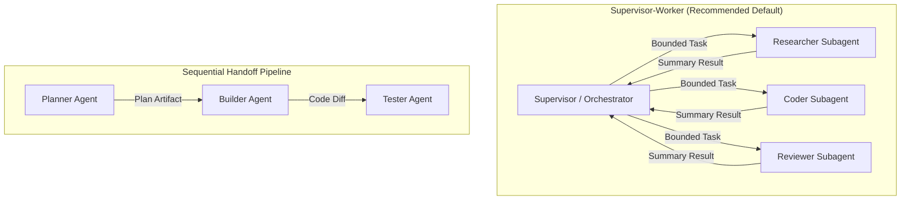

# Agent-to-Agent (A2A) Orchestration & Communication

Engineering standards and behavioral guidelines for designing robust, predictable multi-agent architectures where autonomous agents communicate, delegate, and collaborate.

---

## When to Use This Skill

- **Trigger Scenarios:**
  - When designing or configuring multi-agent systems involving an orchestrator and subagents.
  - When defining communication schemas, message envelopes, and return payloads between agents.
  - When implementing agent handoffs (e.g. Architect → Implementer → Reviewer → Tester).
  - When decoupling long-running exploration into isolated subagents to preserve primary context tokens.
  - When designing shared state mechanisms (Blackboard pattern / artifact exchange).
  - When debugging multi-agent issues: infinite communication loops, task hallucination, or tool privilege leakage.

- **When NOT to Use:**
  - Do not use for single-agent prompts that execute tasks directly without delegation.
  - Do not use for traditional HTTP REST API design between non-agent services (use `api-design`).

---

## 1. Core A2A Collaboration Topologies

Choose the simplest topology that satisfies the problem. Avoid arbitrary mesh communication.



### Topology Decision Matrix

| Topology | Best For | Tradeoffs |
|---|---|---|
| **Supervisor-Worker (Hub & Spoke)** | Complex coding projects, quality gates, bounded execution | Centralized control; supervisor must aggregate and reconcile outputs. |
| **Sequential Handoff (Pipeline)** | Deterministic multi-stage tasks (Plan → Build → Test) | Rigid ordering; upstream errors propagate if not caught by validation. |
| **Blackboard (Artifact-Mediated)** | Parallel research, large codebases, async tasks | Requires structured disk files for state exchange; loose synchronization. |

---

## 2. The Structured A2A Message Envelope

Agents must never exchange unstructured conversational chatter. All inter-agent delegations and returns must follow a strict, typed envelope:

### Task Delegation Envelope (Supervisor → Worker)
```json
{
  "task_id": "task_2026_auth_refactor_01",
  "parent_task_id": "epic_security_hardening",
  "from_agent": "orchestrator",
  "to_agent": "code-reviewer",
  "objective": "Audit src/auth/token.py for JWT expiration and algorithm confusion vulnerabilities.",
  "context_files": [
    "src/auth/token.py",
    "src/config.py"
  ],
  "constraints": {
    "read_only": true,
    "max_duration_seconds": 120,
    "allow_edits": false
  },
  "expected_output_format": "JSON with severity, findings, and remediation diff"
}
```

### Task Return Envelope (Worker → Supervisor)
```json
{
  "task_id": "task_2026_auth_refactor_01",
  "status": "COMPLETED",
  "summary": "Audited token.py. Identified 1 High-severity vulnerability (missing 'none' algorithm rejection).",
  "artifacts_created": [
    "docs/security/audit_token_report.md"
  ],
  "blocking_issues": [],
  "recommended_next_step": "Dispatch builder agent to patch line 42 in src/auth/token.py."
}
```

---

## 3. Context Boundary Isolation & Token Preservation

The primary failure mode in multi-agent systems is **context contamination** — dumping the full trajectory (all 50 tool calls, raw shell outputs, and trial-and-error logs) of a subagent back into the supervisor.

### The Return Summary Principle
1. **Isolated Execution:** The worker subagent spawns with its own clean context window.
2. **Heavy Lifting Inside Subagent:** The worker reads files, runs linters, and executes tests.
3. **Surgical Return:** The worker returns *only* the return envelope: a concise 3–5 bullet summary, list of files created/modified, and pass/fail verification results.
4. **Token Efficiency:** The supervisor's context window stays clean and focused on high-level reasoning.

---

## 4. Preventing Multi-Agent Deadlocks & Recursion

Unconstrained agents can enter infinite clarification loops or recursively spawn subagents without bounds.

### Mandatory Safeguards
1. **Recursion Depth Limit (`max_depth = 2`):**
   - Supervisor (depth 0) may spawn Workers (depth 1).
   - Workers may NOT spawn further subagents unless explicitly permitted, capped at depth 2.
2. **Clear Completion Criteria:**
   - Every delegation must state verifiable success criteria (e.g. `pytest tests/test_auth.py passes`).
3. **Clarification Circuit Breaker:**
   - If an agent requests clarification on the same question twice, halt execution and escalate to the human user.
4. **Idempotent Identifiers:**
   - Every subagent task must have a unique, deterministic `task_id` to prevent duplicate re-execution.

---

## 5. Security & Least-Privilege Tool Scoping

Never grant full administrative shell access to all subagents. Scope tools strictly to agent responsibilities:

| Agent Role | Allowed Tools | Prohibited Tools |
|---|---|---|
| **Researcher / Auditor** | `ReadFile`, `GrepSearch`, `ListDir`, `ReadUrlContent` | `EditFile`, `WriteFile`, `RunCommand` |
| **Builder / Implementer** | `ReadFile`, `EditFile`, `WriteFile`, `RunCommand(test-only)` | `GitPush`, destructive bash commands |
| **Reviewer / Verifier** | `ReadFile`, `GrepSearch`, `RunCommand(linter-only)` | `EditFile`, `WriteFile` |
| **Orchestrator** | `SpawnSubagent`, `ReadArtifact`, `CommunicateUser` | Direct low-level file edits |

---

## 6. Code Patterns: Orchestrator Delegation Loop

### Recommended Pattern (DO THIS)
```python
# GOOD: Explicit task boundaries, isolated context, typed summary
class AgentCoordinator:
    def delegate_review(self, target_file: str) -> ReviewResult:
        subagent = Subagent(
            name="security-reviewer",
            system_prompt="You are a security auditor. Report vulnerabilities as structured JSON.",
            tools=[ReadFileTool(), GrepTool()], # Strictly read-only
            max_turns=10,
        )
        
        # Subagent executes in isolated context
        raw_response = subagent.run(f"Audit {target_file} for security flaws.")
        
        # Parse into typed contract before returning to orchestrator
        return ReviewResult.model_validate_json(raw_response)
```

### Anti-Pattern (AVOID THIS)
```python
# BAD: Unbounded tools, dumping raw history into supervisor, infinite loop risk
def delegate_bad(prompt):
    # Passes all tools including shell and bash
    agent = Agent(tools=ALL_TOOLS) 
    # Loops infinitely if agent asks questions back without human in the loop
    return agent.run_interactive_loop(prompt)
```

---

## Self-Verification Checklist

Before deploying or executing an A2A multi-agent workflow:
- [ ] Topology is explicitly defined (Supervisor-Worker or Pipeline); no uncontrolled peer meshes.
- [ ] Subagents have strictly scoped, least-privilege toolsets (e.g. auditors are read-only).
- [ ] Inter-agent messages adhere to a structured envelope with explicit objectives and constraints.
- [ ] Context isolation is enforced: workers return concise summaries and artifact paths, not raw transcripts.
- [ ] Safeguards against recursion (`max_depth`) and infinite ping-pong loops are in place.
- [ ] Every delegated task includes verifiable completion criteria.
