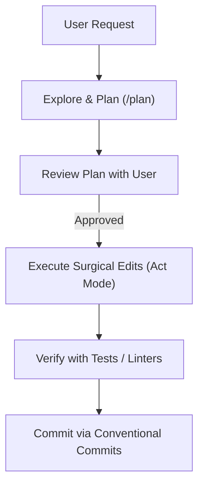

# Advanced Claude Code Workflows

Best practices for driving high-productivity interactive and automated development sessions with Claude Code.

---

## When to Use This Skill

- **Trigger Scenarios:**
  - When initiating complex multi-file engineering tasks requiring Plan Mode (`/plan`).
  - When sessions grow long and context windows need pruning via `/compact`.
  - When running headless non-interactive coding commands with `claude -p`.
  - When delegating background subtasks to isolated subagents or git worktrees.
  - When setting up project-level standing instructions in `CLAUDE.md`.
  - When authoring custom project slash commands.

- **When NOT to Use:**
  - Do not use for general git syntax questions (use `git-workflow`).
  - Do not use for model inference server parameters (use `ollama-modelfile-tuning`).

---

## 1. Plan Mode vs Act Mode

Claude Code operates with distinct cognitive phases:



### Plan Mode Workflow
1. Switch to plan mode or prompt: *"Analyze this repository and formulate a step-by-step plan before writing code."*
2. Inspect directory structures, interfaces, and test files using read-only operations.
3. Present the plan:
   - Components to be added/modified.
   - Potential breaking changes or tradeoffs.
   - Verification steps for each phase.
4. Obtain user confirmation before executing file edits.

---

## 2. Context Window Health & Compaction

Long-running conversations accumulate token overhead that slows responses and degrades reasoning.

- **Use `/compact` proactively:**
  - Run `/compact` after completing a discrete milestone (e.g., after an implementation phase before writing tests).
  - Summarize completed work and active variables into persistent notes.
- **Use `/clear` between tasks:**
  - Never run multiple unrelated tasks in the same continuous context. Use `/clear` to start fresh.

---

## 3. Parallel Sessions with Git Worktrees

Never fight branch switching while a Claude session is actively running. Use git worktrees to run parallel sessions on separate branches simultaneously:

```bash
# Branch A: Refactoring database
git worktree add ../refactor-db -b refactor/db-connection
cd ../refactor-db && claude

# Branch B: Feature auth (in another terminal)
git worktree add ../feat-auth -b feat/oauth
cd ../feat-auth && claude
```

---

## 4. Headless Scripted Automation (`claude -p`)

Claude Code can be invoked directly inside shell scripts and CI/CD pipelines:

```bash
# Automated code review
claude -p "Review git diff against main and output a security and style checklist"

# Automated test generation
claude -p "Generate pytest unit tests for all functions in src/utils.py"

# Piping output to files
claude -p "Summarize all open issues in docs/ROADMAP.md" > summary.md
```

---

## 5. Subagents: Background Delegation

For tasks that require long-running research or extensive file parsing:
1. Delegate bounded research questions to a subagent context.
2. Let the subagent report back concise summaries to the primary session.
3. This preserves primary conversation tokens for high-level reasoning and user communication.

---

## Self-Verification Checklist

Before concluding your Claude Code operational session:
- [ ] Major design decisions were planned and verified before applying file edits.
- [ ] Context was compacted or cleared between distinct tasks to avoid hallucination drift.
- [ ] Parallel tracks were isolated in separate git worktrees to prevent merge collisions.
- [ ] Output from automated `claude -p` commands was validated with test suites.
- [ ] Changes were checked against `CLAUDE.md` guidelines.
